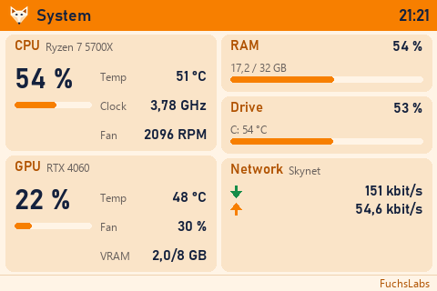
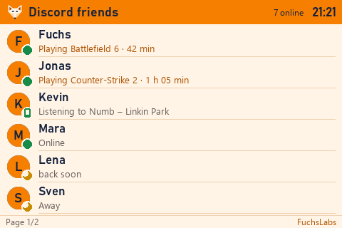
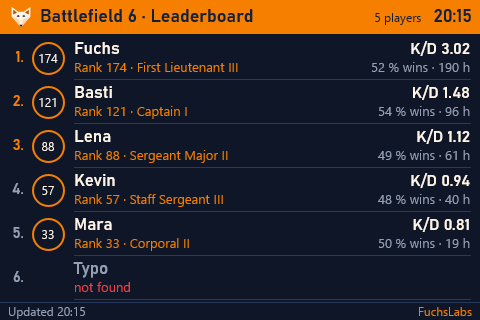
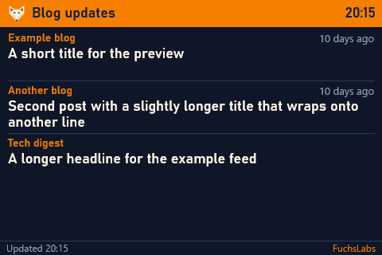
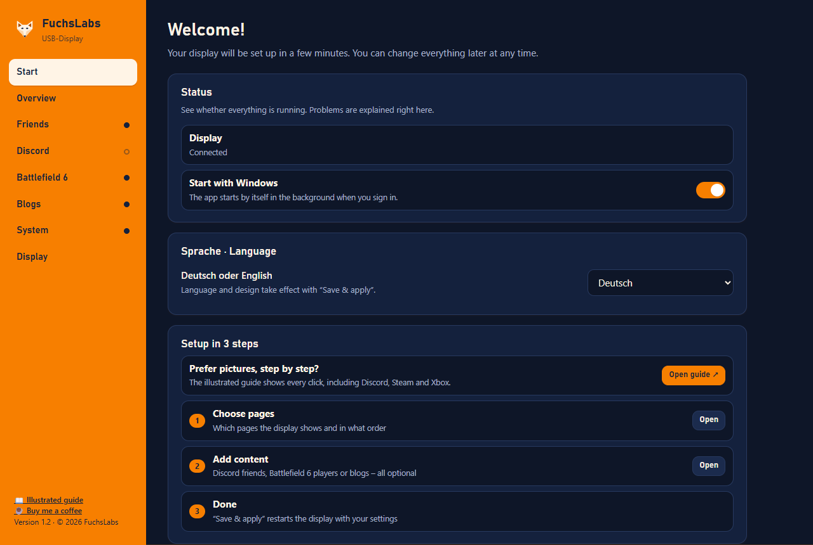
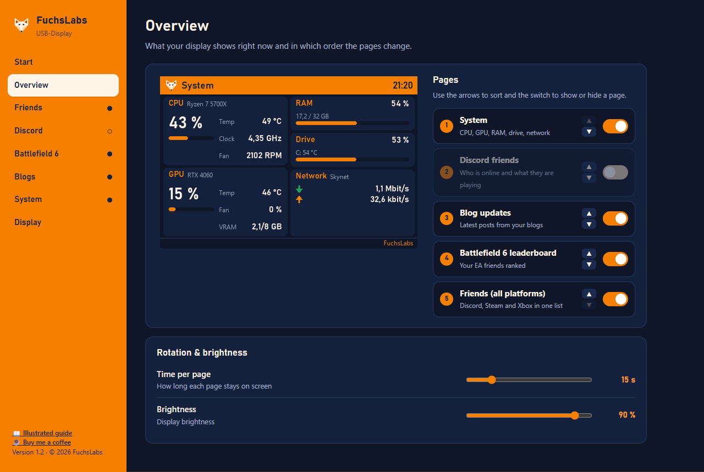
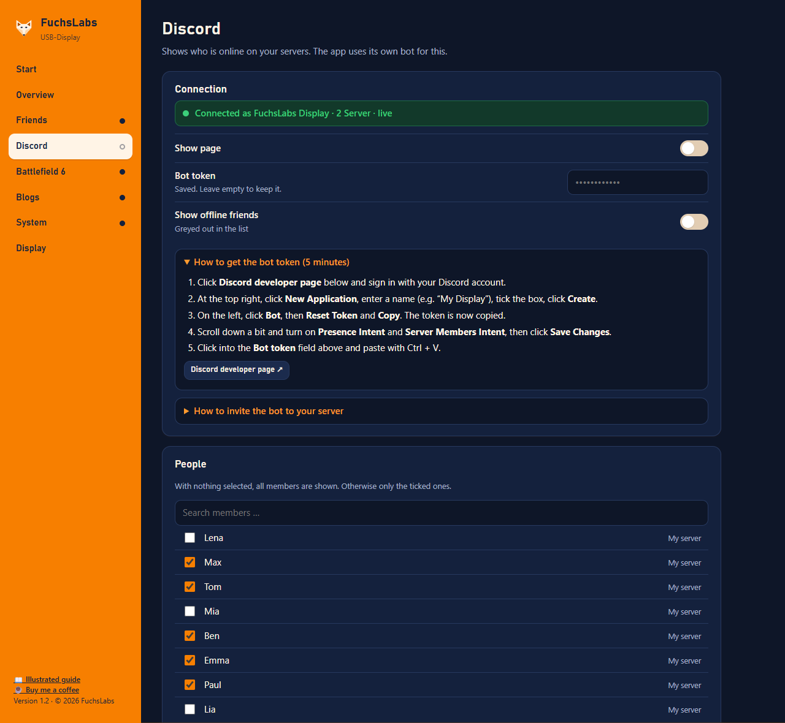
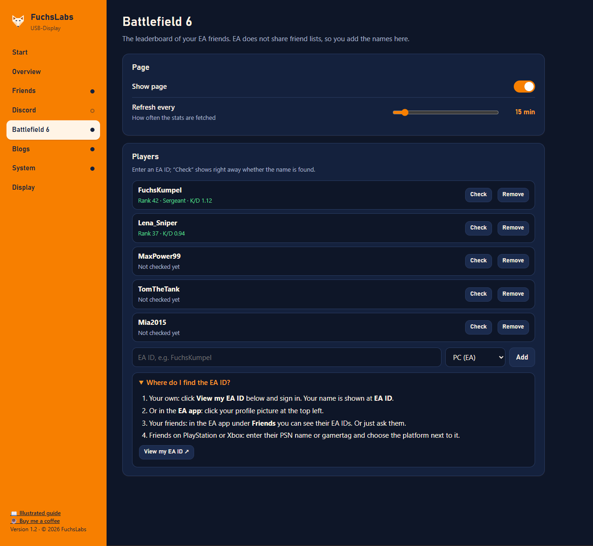

<div align="center">


<br>

# ScreenBuddy

[Deutsch](README.md) · **English**

**Your second screen shows what matters to you: system stats, friends, game rankings and news.**


[](https://www.paypal.me/SHerbst84)

&nbsp;


</div>

A Windows app for 3.5-inch USB displays (480 × 320) and HDMI/USB-C secondary screens, including touch. It runs in the background and provides native Windows settings. The C++20 app and installer are one EXE; no Python, WebView2 or Visual C++ redistributable is required.

**New in 2.9.4:** tap a streaming movie or series to open its TMDB details in the PC browser; tap Spotify cover art to open the Spotify desktop app. TMDB key application explained with field examples. [Release notes 2.9.4](docs/RELEASE-NOTES-2.9.4.md). New tabs follow browser settings; verified with Chrome on Meanmachine.

**New in 2.9.3:** PlayStation friends in the combined friends list (badge “P”, online status and current game). Sony offers no official interface for this: the feature uses the NPSSO code of your PlayStation sign-in, is **unofficial**, **optional**, **off by default** and **at your own risk** (Sony may change it at any time or restrict the account). The code is stored DPAPI-encrypted and sent only to Sony; an authorisation code with a dot (`v3.…`) is accepted. [Release notes 2.9.3](docs/RELEASE-NOTES-2.9.3.md).

**New in 2.9.2:** Cupertino: collapsible sidebar and optional inspector; Fluent: page search and Back history; Material: five destinations, subpages and floating save actions for pending changes. System displays also use distinct compositions. Cupertino, Fluent and Material design profiles control shapes, typography, spacing and native interaction feedback as well as colors. [Details and limits](docs/THEMES.md#design-systems-since-292).

All three design systems have paired light/dark palettes, six examples and a native appearance switch that keeps the selected profile.

**In 2.9.1:** three installable store themes, status-dot tooltips, key help with official links, audio device change detection, simulated amplifier for remote playback and selectable bar colors; contrast and brush-cache fixes. [Release notes 2.9.1](docs/RELEASE-NOTES-2.9.1.md).

**New in 2.9.0:** colors & design (match Windows, custom themes with editor, import/export and three example themes), uniform status dots with legend in the navigation, a fair mix of all chosen providers on the streaming page, spectrum amplifier on the Spotify page, Android TV entry for the Companion app and the official TMDB logo; see [Release notes 2.9](docs/RELEASE-NOTES-2.9.md) (German/English).

**New in 2.8.0:** Spotify page (track, cover, touch buttons; [guide](docs/SPOTIFY.en.md)) and a “New on streaming” page with TMDB data; fix for the uninstall guard in test instances. [Release notes 2.8](docs/RELEASE-NOTES-2.8.md) (German/English).

**New in 2.7.0:** several Companion devices at once (synchronised or independent), sortable and hideable plugin pages, signed store preview images, interactive Plugin Workshop; store installations stay disabled until you enable them. [Release notes 2.7](docs/RELEASE-NOTES-2.7.md) (German/English).

## Contents

- [Features](#features)
- [Pictures](#pictures)
- [Quick start](#quick-start)
- [Configuration](#configuration)
- [Supported hardware](#supported-hardware)
- [Building and development](#building-and-development)
- [Project layout](#project-layout)
- [Security and privacy](#security-and-privacy)
- [Testing and feedback](#testing-and-feedback)
- [Documents](#documents)
- [Licence](#licence)

## Features

| Page | Content | Source | Refresh |
|---|---|---|---|
| **System** | CPU (load, clock, temperature, fan), GPU (load, temperature, fan, VRAM), RAM, drive, network with history | Windows APIs, `nvidia-smi`, HWiNFO shared memory | every second |
| **Friends** | Discord, Steam, Xbox and (new in 2.9.3, optional) PlayStation in one list; each person appears only once | your own Discord bot, Steam Web API, [OpenXBL](https://xbl.io), PlayStation only via Sony’s unofficial interface (NPSSO code, default: off) | instant / 1 min / 3 min / 2 min |
| **Discord friends** | status, activity, avatar | your own Discord bot | instant |
| **Battlefield 6 · Leaderboard** | the EA friends you add, ranked, with badge, K/D and win rate | [gametools.network](https://api.gametools.network) | 15 min |
| **Blog updates** | newest post per blog; the app finds the feed itself | RSS/Atom | 30 min |
| **New on streaming** (new in 2.8.0) | new movies and series of the last 30 days on your chosen streaming services (title, date, movie/series, service) | [TMDB](https://www.themoviedb.org) API, provider data from JustWatch; your own key | 1 h |
| **Home Assistant** | up to 4 sensors (value, unit) or switches (flippable by touch) | Home Assistant REST API | 15 s |
| **Spotify** (new in 2.8.0) | current track with cover and progress, amplifier bars in landscape; with touch previous/pause/next (Premium) | Spotify Web API, [guide](docs/SPOTIFY.en.md) | 4 s |
| **Plugins** | your own pages from reviewed, declarative plugins | plugin store or local manifest | per plugin |

 *New on streaming uses the TMDB API: This product uses the TMDB API but is not endorsed or certified by TMDB. Provider data: JustWatch.*

Plus:

- **Native Windows settings window** (Direct2D/DirectWrite, no WebView2) with live preview, page order, connection status per platform and fold-out help next to every key field. The local service at `http://127.0.0.1:8765/` provides the local API, the guide at `/anleitung` and the Plugin Workshop at `/plugin-werkstatt`; the Companion connection runs separately on port 8777.
- **First-run setup without prior knowledge**: detects the display, closes and disables the vendor app if you want, autostart without admin rights
- **Plugin store** (from 2.6.0, can be switched off): signed store with checks before installation; plugins stay off until you enable them. More: [Plugin store and plugins](docs/FEATURES.en.md#plugin-store-and-plugins-from-260)
- **Android Companion** (from 2.3.0, several devices from 2.7.0): phone or tablet as an additional display, pairing via QR code or PIN. More: [Companion](docs/FEATURES.en.md#android-companion-app-from-230-multiple-devices-from-270)
- **Design**: FuchsLabs style in light or dark, **match Windows** (light/dark and accent colour, live) or **custom themes** (JSON, editor with contrast warning, import/export), see [docs/THEMES.md](docs/THEMES.md)
- **Any resolution**: pages are rendered sharply at the real size; wide bars show several pages side by side
- **HDMI/USB-C screens** as borderless fullscreen above the taskbar, optionally with **touch** (swipe or tap to change pages; taps on posts, friends, players and system cards open matching targets); Windows touch assignment checks and setup under **Display**. Details: [touch and update notice](docs/FEATURES.en.md#system-page-touch-and-update-notice-from-220), [touch targets](docs/FEATURES.en.md#touch-targets-and-playtime-from-208)
- **Home Assistant** with sensors and switches: [setup and security notes](docs/FEATURES.en.md#home-assistant-from-210)
- **German or English**: the settings page, display and tray menu can be switched; on first start the language follows Windows
- **Illustrated guide** to click through, easy enough for kids, embedded in the EXE in English and German
- **Step through pages** with a button (Companion page of the settings): [description](docs/FEATURES.en.md#browse-views-from-204)
- **Update notice** (can be turned off): reports a new GitHub version at most once a day, but never installs by itself
- **Single EXE** for installation, updates and uninstallation

## Pictures

| Display | |
|---|---|
|  |  |
| Battlefield 6 leaderboard (dark) | Blog updates (dark) |

| Settings page | |
|---|---|
|  |  |
| Start with first-run setup | Overview with live preview |
|  |  |
| Discord with fold-out help | Add and check Battlefield 6 players |

All pictures show sample data; some screenshots are from the previous 1.x UI.

## Quick start

1. Download **ScreenBuddy.exe** from [release 2.9.4](https://github.com/PapaFuchs84/ScreenBuddy/releases/tag/v2.9.4). The Windows EXE is unsigned; verify it against `SHA256SUMS.txt`. The Companion app for Android is a separate download (see the release page for its version).
2. Use Windows 10/11 x64. From version 2.5 onwards **no** Microsoft Edge WebView2 runtime is required; the earlier version 2.3.0 still needs it.
3. Connect the display, run the EXE and complete the installer. Default location: `%LOCALAPPDATA%\FuchsLabs\USB-Display`, without administrator rights.
4. On first setup, settings open in their own Windows window. Choose **EN** with the **DE | EN** switch at the top right of the settings window, then **Save & apply**.
5. Configure pages and data sources. Reopen settings by double-clicking the fox tray icon, via its **Open settings** menu entry, or by starting the installed app again. Closing the settings window leaves the display running; use **Quit** in the tray to stop it.

The installer can import Version 1.x settings and retains the old folder with a `-1.x-alt` suffix. Updates keep an existing destination configuration. Back up the EXE, `config.toml` and `companion.json` before every upgrade. The illustrated guide opens in your default browser via **Open guide** in the fox icon menu and is embedded in the EXE.

For an HDMI/USB-C touchscreen, choose the intended monitor under **Display**. If taps appear on another screen, select **Assign touchscreen**, press Enter to skip other screens, and touch the intended touchscreen. Then select **Check again**. A USB touch connection is required. See [HDMI/USB-C and touch](cpp/README.md#hdmiusb-c-and-touch).

### Logins for the data sources

| Source | What you need | Cost |
|---|---|---|
| Discord | your own bot in the [Developer Portal](https://discord.com/developers/applications) with *Presence Intent* and *Server Members Intent*, invited to your server | free |
| Steam | a [Steam Web API key](https://steamcommunity.com/dev/apikey) and your profile link; friends list set to “Public” | free |
| Xbox | a key from [OpenXBL](https://xbl.io) | free tier |
| PlayStation (optional, unofficial) | the NPSSO code of your PlayStation sign-in; expires after about two months, works like a password, use at your own risk | free |
| Battlefield 6 | just your friends' EA IDs | free |
| CPU temperature and fan | [HWiNFO64](https://www.hwinfo.com/), set up with `hwinfo-einrichten.bat` | free |

An automatic EA friend list is deliberately not included (no official API). PlayStation friends are only available through Sony’s unofficial interface (NPSSO code, at your own risk; Sony may change it at any time or restrict the account). It is optional and off by default.

## Configuration

Everything can be set on the settings page. The regular installation stores `config.toml` and `usb-display.log` in `%LOCALAPPDATA%\FuchsLabs\USB-Display`. Custom `-c` and `--log` paths override this. An excerpt:

```toml
[display]
output = "serial"          # "serial" = 3.5" USB display, "monitor" = HDMI/USB-C screen
orientation = "landscape"  # also reverse_landscape, portrait, reverse_portrait
brightness = 90
page_seconds = 15
pages = ["system", "friends", "discord", "bf6", "rss", "streaming", "homeassistant", "spotify"]   # order
theme = "hell"             # "hell" (light), "dunkel" (dark), "windows" or "custom:<id>"
touch = true               # only with output = "monitor"

[bf6]
enabled = true
players = ["FuchsKumpel", "Lena_Sniper@psn"]

[rss]
enabled = true
feeds = ["https://www.theverge.com/"]

[streaming]
enabled = true
region = ""                # empty = German: DE, English: US
providers = ["8|Netflix", "337|Disney+"]   # TMDB provider IDs; the key is stored encrypted in api_key

[spotify]
enabled = true
client_id = ""             # client ID of your Spotify developer app

[homeassistant]
enabled = true
url = "http://homeassistant.local:8123"
entities = ["sensor.living_room_temperature", "light.floor_lamp"]

[ui]
language = "en"            # "de" or "en"
```

Tokens and keys are only stored encrypted (`dpapi:…`). All keys with their defaults are described in [`DOKUMENTATION.md`](DOKUMENTATION.md#4-konfigurationsdatei) (German).

### Command line

| Option | Effect |
|---|---|
| `-c FILE` | use a different configuration file |
| `--demo` | show all pages with sample data |
| `--no-lcd` | start without a display (for testing the settings page) |
| `--preview FOLDER` | also save every frame as PNG |
| `--log FILE`, `-v` | log to a file, verbose |

## Supported hardware

| Device | Connection | Note |
|---|---|---|
| 3.5" USB display 480 × 320 (“revision A”) | USB (serial, 115200 baud) | found automatically; COM port can be set by hand |
| Second screen of any size (example in the tests: 1920 × 720) | HDMI or USB-C (DisplayPort) | borderless full screen on the chosen screen, optional touch |
| Android phone or tablet (Android 8+) | Wi-Fi/USB tethering, Companion app | several devices possible |
| GPU stats | Nvidia with driver (`nvidia-smi`) | other GPUs show “–” |

## Building and development

Requirements: Windows x64, Visual Studio Build Tools 2022 with C++/Windows SDK and CMake/Ninja, plus a bootstrapped vcpkg checkout at `%USERPROFILE%\FuchsLabs\vcpkg`.

```bat
git clone https://github.com/PapaFuchs84/ScreenBuddy.git
cd ScreenBuddy\cpp
build.bat nopause
```

The C++ build installs dependencies from the pinned vcpkg manifest/overlay, builds Release, runs core, plugin, monitor, Companion and isolated installer checks, and writes `cpp\dist\ScreenBuddy.exe` locally. The root `build.bat` belongs to the historical Python 1.x version. See [C++ build notes](cpp/README.md#build), [architecture](docs/ARCHITEKTUR.md) (German) and the [contribution guide](CONTRIBUTING.en.md).

App translations are in `cpp/src/i18n.cpp`, native page text under `cpp/src/ui_page_*.cpp`. WebView2 files remain only under `cpp/third_party/webview2` and are not linked; `/` no longer serves HTML settings.

## Project layout

| Path | Purpose |
|---|---|
| `cpp/src/` | C++ application, display output, data sources, native settings host and installer |
| `cpp/res/` | Embedded guides, icon and version resources |
| `cpp/tests/` | C++ checks |
| `cpp/overlay-ports/`, `cpp/vcpkg.json` | Dependency versions and D++ build settings |
| `cpp/TESTPROTOKOLL.md` | Local Windows/display validation record |
| `android/` | Android Companion app |
| `docs/` | Technical documentation, see the [overview](docs/README.md) (German) |
| Root `*.py`, root `build.bat`, `anleitung/` | Historical Python 1.x sources and generation of the current DE/EN guide |

## Security and privacy

- Runs **without admin rights**, no telemetry, no account. The only request of its own besides your data sources is the update notice to the public GitHub releases (can be turned off; at most once a day, no key).
- Credentials are stored encrypted with **Windows DPAPI**, never logged and never sent to the browser.
- The local service is **only reachable on `127.0.0.1`** and protected against DNS rebinding, CSRF and framing by other sites.
- All connections use HTTPS with certificate checks; packages are pinned to exact versions.

Historical Python 1.x review: [`SICHERHEITSREVIEW.md`](SICHERHEITSREVIEW.md) (German); it is not a complete C++ audit. Current validation: the [test record](cpp/TESTPROTOKOLL.md) (German) has the entry “Release 2.9.4” (31 October 2026); the 2.9.x release notes are listed under [Documents](#documents). Report a vulnerability as described in [`SECURITY.en.md`](SECURITY.en.md), please not as a public issue.

## Testing and feedback

The app is in testing. Please report bugs and ideas via **Issues → New issue** using the “Bug report” or “Idea or feedback” forms. Where to find the log `usb-display.log` and what must never be sent: [`TESTPHASE.en.md`](TESTPHASE.en.md).

**Validation of 2.9.3:** release build green with all built-in suites (among them 1357 core, 119 TMDB, 251 plugin, 127 store, 140 transport, 135 settings and 361 Companion checks, plus two installer checks); the EXE reports 2.9.3; on the real system COM7 was connected and the Companion server started, Redmi and Android TV showed pages (adb screenshots). PlayStation live returned one account with a fresh code. **Not verified:** PlayStation status/game on the devices, store install/update through the UI, and physical acceptance. Details and limits: [test record](cpp/TESTPROTOKOLL.md) (German). Previous state: [release notes 2.8](docs/RELEASE-NOTES-2.8.md) (1,507 checks). Earlier results: [history](docs/PRUEFSTAND-HISTORIE.md) (German).

## Documents

All documents by audience (German): [`docs/README.md`](docs/README.md). The most important ones:

| File | Content |
|---|---|
| [`README.md`](README.md) | this README in German |
| [`docs/FEATURES.en.md`](docs/FEATURES.en.md) | features in detail ([Deutsch](docs/FUNKTIONEN.md)) |
| [`docs/PLUGIN-SYSTEM.en.md`](docs/PLUGIN-SYSTEM.en.md) | plugin guide ([Deutsch](docs/PLUGIN-SYSTEM.md)), [tutorial](docs/PLUGIN-TUTORIAL.en.md), [store terms](docs/PLUGIN-STORE-TERMS.md) |
| [`docs/COMPANION.en.md`](docs/COMPANION.en.md) | Companion setup ([Deutsch](docs/COMPANION.md)) |
| [`docs/RELEASE-NOTES-2.9.3.md`](docs/RELEASE-NOTES-2.9.3.md) | release notes of the current version (German/English; earlier: [2.9.2](docs/RELEASE-NOTES-2.9.2.md), [2.9.1](docs/RELEASE-NOTES-2.9.1.md), [2.9](docs/RELEASE-NOTES-2.9.md)) |
| [`CHANGELOG.en.md`](CHANGELOG.en.md) | changes per version ([Deutsch](CHANGELOG.md)) |
| [`CONTRIBUTING.en.md`](CONTRIBUTING.en.md) | contributing ([Deutsch](CONTRIBUTING.md)) |
| [`SECURITY.en.md`](SECURITY.en.md) | reporting vulnerabilities ([Deutsch](SECURITY.md)) |
| [`TESTPHASE.en.md`](TESTPHASE.en.md) | feedback during testing ([Deutsch](TESTPHASE.md)) |
| [`DOKUMENTATION.md`](DOKUMENTATION.md) | full reference (German) |
| [`ANLEITUNG.md`](ANLEITUNG.md) | quick start for users (German) |
| [`docs/ARCHITEKTUR.md`](docs/ARCHITEKTUR.md) | architecture for developers (German) |

## Support

Like the app? FuchsLabs appreciates a coffee: [☕ paypal.me/SHerbst84](https://www.paypal.me/SHerbst84)

## Licence

The code is released under the [MIT License](LICENSE), © 2026 FuchsLabs. The name and fox-head logo are excluded ([TRADEMARKS.md](TRADEMARKS.md)). Third-party components retain their own licences ([THIRD-PARTY-NOTICES.md](THIRD-PARTY-NOTICES.md)).

Battlefield, Discord, Steam, Xbox and PlayStation are trademarks of their respective owners. FuchsLabs is not affiliated with them.
