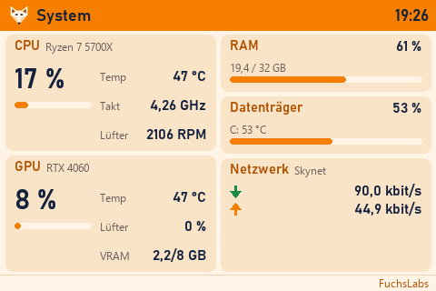
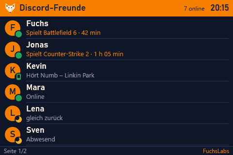
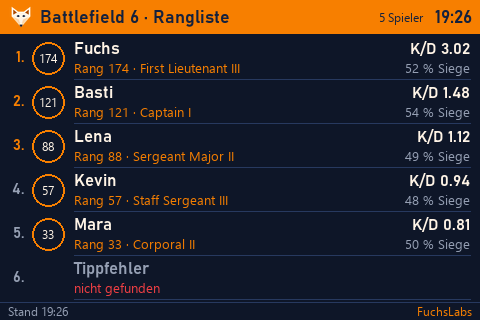
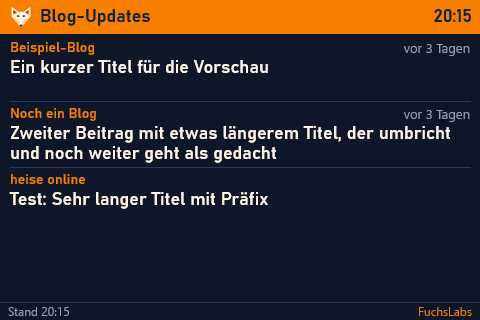
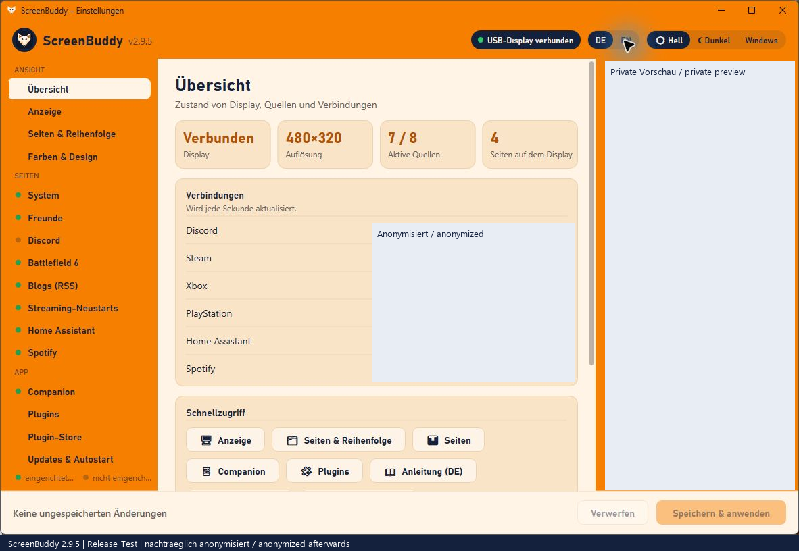
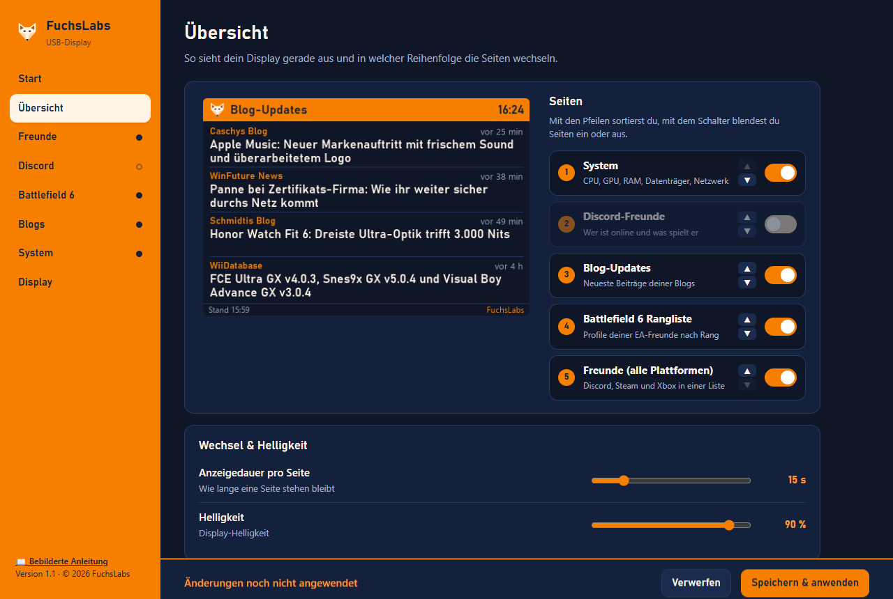
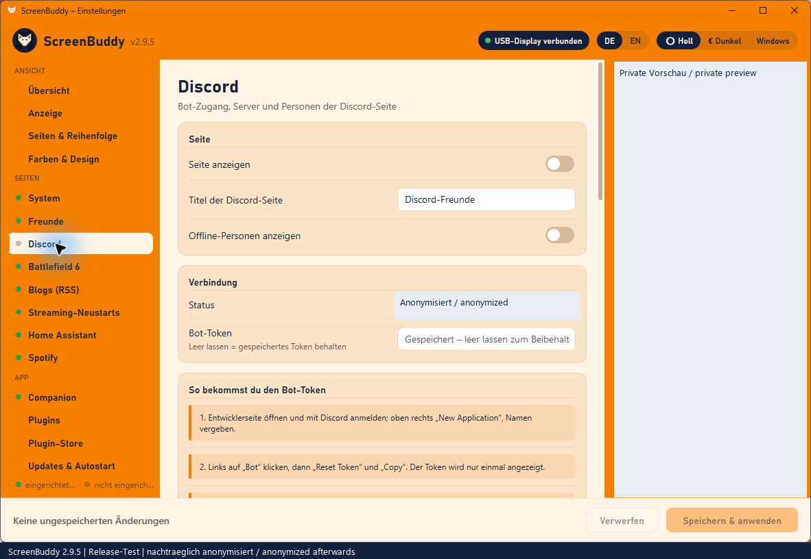
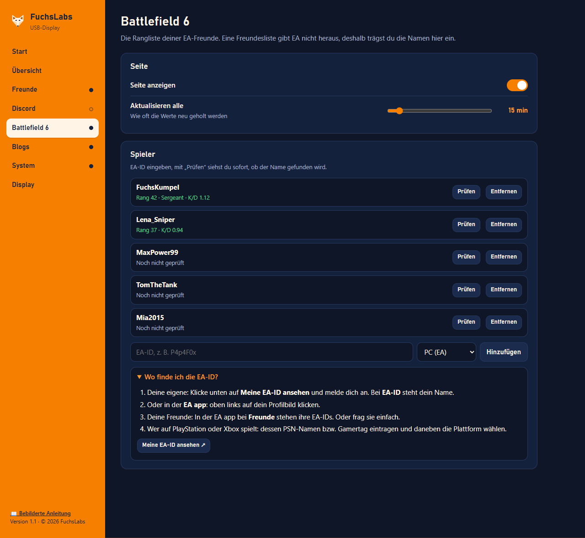

<div align="center">

# 🦊 FuchsLabs USB-Display

**Deutsch** · [English](README.en.md)

**Dein Zusatzbildschirm zeigt, was dich interessiert: Systemwerte, Freunde, Spielstände und Neuigkeiten.**


[](https://www.paypal.me/SHerbst84)

&nbsp;


</div>

Windows-App für 3,5"-USB-Displays (480 × 320) und Zusatzbildschirme über HDMI/USB-C in jeder Auflösung (z. B. 10,25"-Leisten mit 1920 × 720, auch mit Touch). Sie ersetzt die Hersteller-App, läuft unauffällig im Hintergrund und wird komplett über eine Einstellungsseite im Browser bedient. Python oder Vorkenntnisse braucht dafür niemand.

## Inhalt

- [Funktionen](#funktionen)
- [Bilder](#bilder)
- [Schnellstart](#schnellstart)
- [Konfiguration](#konfiguration)
- [Unterstützte Hardware](#unterstützte-hardware)
- [Selbst bauen und entwickeln](#selbst-bauen-und-entwickeln)
- [Projektaufbau](#projektaufbau)
- [Sicherheit und Datenschutz](#sicherheit-und-datenschutz)
- [Testphase und Rückmeldungen](#testphase-und-rückmeldungen)
- [Dokumente](#dokumente)
- [Lizenz](#lizenz)

## Funktionen

| Seite | Inhalt | Quelle | Aktualisierung |
|---|---|---|---|
| **System** | CPU (Last, Takt, Temperatur, Lüfter), GPU (Last, Temperatur, Lüfter, VRAM), RAM, Datenträger, Netzwerk mit Verlauf | Windows-APIs, `nvidia-smi`, HWiNFO-Shared-Memory | jede Sekunde |
| **Freunde** | Discord, Steam und Xbox in einer Liste; dieselbe Person erscheint nur einmal | eigener Discord-Bot, Steam Web API, [OpenXBL](https://xbl.io) | sofort / 1 min / 3 min |
| **Discord-Freunde** | Status, Aktivität, Avatar | eigener Discord-Bot | sofort |
| **Battlefield 6 · Rangliste** | eingetragene EA-Freunde nach Rang, mit Abzeichen, K/D und Siegquote | [gametools.network](https://api.gametools.network) | 15 min |
| **Blog-Updates** | neuester Beitrag je Blog; den Feed findet die App selbst | RSS/Atom | 30 min |

Dazu kommen:

- **Einstellungsseite** unter `http://127.0.0.1:8765/` mit Live-Vorschau, Seitenreihenfolge, Verbindungsstatus je Plattform und aufklappbaren Hilfen neben jedem Schlüsselfeld
- **Ersteinrichtung ohne Vorkenntnisse**: erkennt das Display, beendet und deaktiviert auf Wunsch die Hersteller-App, Autostart ohne Administratorrechte
- **Design**: FuchsLabs-CI in Hell oder Dunkel, oder **eigene Farben** per Farbwähler mit Kontrastwarnung
- **Jede Auflösung**: Seiten werden scharf auf die echte Größe gerendert; breite Leisten zeigen mehrere Seiten nebeneinander
- **HDMI/USB-C-Bildschirme** als randloses Vollbild, optional mit **Touch** (wischen oder tippen zum Blättern)
- **Deutsch oder Englisch**: Einstellungsseite, Display und Infobereich lassen sich umschalten; beim ersten Start folgt die Sprache Windows
- **Bebilderte Anleitung** zum Durchklicken, verständlich auch für Kinder, auf Deutsch (`ANLEITUNG.html`) und Englisch (`GUIDE.html`)
- **Sparsam**: rund 1 % eines CPU-Kerns und etwa 90 MB Arbeitsspeicher

## Bilder

| Display | |
|---|---|
|  |  |
| Battlefield-6-Rangliste (Dunkel) | Blog-Updates (Dunkel) |

| Einstellungsseite | |
|---|---|
|  |  |
| Start mit Ersteinrichtung | Übersicht mit Live-Vorschau |
|  |  |
| Discord mit Hilfe zum Aufklappen | Battlefield-6-Spieler eintragen und prüfen |

Alle Bilder zeigen Beispieldaten.

## Schnellstart

1. **ZIP entpacken** und den Ordner an einen festen Platz legen, z. B. `Dokumente\FuchsLabs-USB-Display`.
2. **Display anstecken** (USB) oder den Zusatzbildschirm per HDMI/USB-C anschließen.
3. **`FuchsLabs-USB-Display.exe` starten.** Warnt Windows („Der Computer wurde durch Windows geschützt“), auf **Weitere Informationen → Trotzdem ausführen** klicken. Die EXE ist nicht signiert.
4. Die **Einstellungsseite** öffnet sich im Browser. Unter **Start** steht, ob das Display erkannt wurde. Dort beendest du bei Bedarf die Hersteller-App und schaltest **Mit Windows starten** ein.
5. Gewünschte Seiten unter **Übersicht** einschalten und die Zugänge eintragen. Jedes Feld hat eine Hilfe zum Aufklappen.
6. **Speichern & anwenden.**

Die Einstellungen öffnest du später per Doppelklick auf das Fuchs-Symbol im Infobereich. Ausführlich und bebildert: `ANLEITUNG.html` im ZIP (englisch: `GUIDE.html`).

### Zugänge für die Datenquellen

| Quelle | Was du brauchst | Kosten |
|---|---|---|
| Discord | eigener Bot im [Developer Portal](https://discord.com/developers/applications) mit *Presence Intent* und *Server Members Intent*, auf deinen Server eingeladen | kostenlos |
| Steam | [Steam-Web-API-Schlüssel](https://steamcommunity.com/dev/apikey) und dein Profil-Link; Freundesliste im Profil auf „Öffentlich“ | kostenlos |
| Xbox | Schlüssel von [OpenXBL](https://xbl.io) | kostenlose Stufe |
| Battlefield 6 | nur die EA-IDs deiner Freunde | kostenlos |
| CPU-Temperatur und Lüfter | [HWiNFO64](https://www.hwinfo.com/), eingerichtet mit `hwinfo-einrichten.bat` | kostenlos |

PlayStation und ein automatischer EA-Freundesabruf sind bewusst nicht eingebaut: Dafür gibt es keine offiziellen Schnittstellen, und inoffizielle Wege können zur Kontosperre führen.

## Konfiguration

Alles lässt sich in der Einstellungsseite einstellen. Sie schreibt `config.toml` neben die EXE (oder nach `%APPDATA%\FuchsLabs\USB-Display`, wenn der Ordner schreibgeschützt ist). Ein Auszug:

```toml
[display]
output = "serial"          # "serial" = 3,5"-USB-Display, "monitor" = HDMI/USB-C-Bildschirm
orientation = "landscape"  # auch reverse_landscape, portrait, reverse_portrait
brightness = 90
page_seconds = 15
pages = ["system", "friends", "discord", "bf6", "rss"]   # Reihenfolge
theme = "hell"             # "hell", "dunkel" oder "eigen"
touch = false              # nur bei output = "monitor"

[bf6]
enabled = true
players = ["FuchsKumpel", "Lena_Sniper@psn"]

[rss]
enabled = true
feeds = ["https://winfuture.de/"]
```

Tokens und Schlüssel stehen dort nur verschlüsselt (`dpapi:…`). Alle Schlüssel mit Standardwerten beschreibt [`DOKUMENTATION.md`](DOKUMENTATION.md#4-konfigurationsdatei).

### Kommandozeile

| Option | Wirkung |
|---|---|
| `-c DATEI` | andere Konfigurationsdatei verwenden |
| `--demo` | alle Seiten mit Beispieldaten zeigen |
| `--no-lcd` | ohne Display starten (zum Testen der Einstellungsseite) |
| `--preview ORDNER` | jedes Bild zusätzlich als PNG speichern |
| `--log DATEI`, `-v` | Protokoll in eine Datei, ausführlich |

Die Sprache steht unter `[ui]` als `language = "de"` oder `"en"`.

## Unterstützte Hardware

| Gerät | Anschluss | Hinweis |
|---|---|---|
| 3,5"-USB-Display 480 × 320 („Revision A“) | USB (serielle Schnittstelle, 115200 Baud) | wird automatisch gefunden; COM-Port bei Bedarf von Hand |
| Zusatzbildschirm beliebiger Größe, z. B. 10,25" 1920 × 720 | HDMI oder USB-C (DisplayPort) | randloses Vollbild auf dem gewählten Bildschirm, optional Touch |
| GPU-Werte | Nvidia mit Treiber (`nvidia-smi`) | andere GPUs zeigen „–“ |

## Selbst bauen und entwickeln

Voraussetzung: Windows 10/11 und Python 3.11+ (64 Bit, von [python.org](https://www.python.org/)).

```bat
git clone https://github.com/PapaFuchs84/fuchslabs-usb-display.git
cd fuchslabs-usb-display
build.bat
```

`build.bat` legt eine eigene `.venv` an, installiert die genau festgelegten Pakete aus `requirements.txt` und `requirements-build.txt` und baut mit PyInstaller nach `dist\FuchsLabs-USB-Display\`. Weitergegeben wird immer der ganze Ordner (die EXE braucht `_internal`).

Ohne EXE entwickeln:

```bat
.venv\Scripts\python fuchslabs_display.py --no-lcd        :: App ohne Display, Einstellungsseite läuft
.venv\Scripts\python fuchslabs_display.py --demo --no-lcd --preview vorschau   :: Beispielbilder aller Seiten
.venv\Scripts\python test_friends.py                      :: Tests für das Zusammenführen der Freundeslisten
```

Die bebilderte Anleitung entsteht aus `anleitung/anleitung.template.html` und den Screenshots in `anleitung/bilder` mit `anleitung/make_images.py`; die englische `GUIDE.html` aus `anleitung/anleitung.template.en.html` mit `make_images.py <englische Screenshots> en`. Die Screenshots nimmt `anleitung/screenshots.mjs` auf (`FL_LANG=en` für Englisch) und ersetzt dabei private Namen durch Beispiele. `anleitung/bilder/freunde.png` ist vorsichtshalber nicht im Repository und wird vor dem Bauen lokal aufgenommen.

Übersetzungen: App- und Display-Texte in `i18n.py`, Texte der Einstellungsseite in der Tabelle `EN` in `webui.html`. Die deutschen Texte im Code sind die Quelle.

Wie du mitarbeitest, steht in [`CONTRIBUTING.md`](CONTRIBUTING.md).

## Projektaufbau

```
fuchslabs_display.py   Hauptprogramm: Start, Einzelinstanz, Seitenrotation, Dienste, Neustart
display_driver.py      Treiber für das serielle 3,5"-Display (RGB565, Teil-Updates in Zeilenbändern)
monitor_output.py      Ausgabe auf HDMI/USB-C-Bildschirm als Vollbildfenster, Touch
render.py              Zeichnet alle Seiten (logisch 480 × 320, skaliert auf jede Auflösung)
brand.py               FuchsLabs-CI: Farben und Fuchs-Logo
sysinfo.py             Systemwerte: Windows-APIs, nvidia-smi, HWiNFO
discord_feed.py        Discord-Bot (nur geladen, wenn gebraucht)
friends.py             Steam, Xbox und Zusammenführen der Freundeslisten
bf6.py, rss.py         Battlefield 6 und Blogs
i18n.py                Sprache: Deutsch/Englisch für Display, Meldungen und Infobereich
appconfig.py           Konfiguration lesen, prüfen, schreiben
secure.py              DPAPI-Verschlüsselung der Zugangsdaten
webui.py, webui.html   Einstellungsseite (lokaler Webserver, eine HTML-Datei)
tray.py, winsetup.py   Symbol im Infobereich, Autostart, Hersteller-App
anleitung/             Quellen der bebilderten Anleitung
docs/screenshots/      Bilder für diese README
```

Ein Prozess mit einer asyncio-Schleife für Anzeige, Datenabrufe, Discord und Webserver; Systemwerte und Infobereich laufen in eigenen Threads. Details in [`DOKUMENTATION.md`](DOKUMENTATION.md#10-technischer-aufbau).

## Sicherheit und Datenschutz

- Läuft **ohne Administratorrechte**, ohne Telemetrie, ohne Konto.
- Zugangsdaten werden mit **Windows-DPAPI** verschlüsselt gespeichert, nie protokolliert und nie an den Browser gegeben.
- Die Einstellungsseite ist **nur auf `127.0.0.1`** erreichbar und gegen DNS-Rebinding, CSRF und Einbetten in fremde Seiten geschützt.
- Alle Verbindungen laufen über HTTPS mit Zertifikatsprüfung; Pakete sind auf genaue Versionen festgelegt.

Prüfbericht: [`SICHERHEITSREVIEW.md`](SICHERHEITSREVIEW.md). Eine Lücke meldest du wie in [`SECURITY.md`](SECURITY.md) beschrieben, bitte nicht als öffentliches Issue.

## Testphase und Rückmeldungen

Die App ist in der Testphase. Fehler und Ideen bitte über **Issues → New issue** mit den Vorlagen „Fehlerbericht“ oder „Idee oder Rückmeldung“ melden. Wo das Protokoll `usb-display.log` liegt und was nie mitgeschickt werden darf, steht in [`TESTPHASE.md`](TESTPHASE.md).

## Dokumente

| Datei | Inhalt |
|---|---|
| [`README.en.md`](README.en.md) | dieses README auf Englisch |
| [`ANLEITUNG.md`](ANLEITUNG.md) | Schnellstart für Anwender |
| [`DOKUMENTATION.md`](DOKUMENTATION.md) | ausführliche Referenz: Seiten, Einstellungen, `config.toml`, HWiNFO, Fehlerbehebung |
| [`CHANGELOG.md`](CHANGELOG.md) | Änderungen je Version ([English](CHANGELOG.en.md)) |
| [`PROTOKOLL.md`](PROTOKOLL.md) | Entstehungsverlauf und Entscheidungen |
| [`SICHERHEITSREVIEW.md`](SICHERHEITSREVIEW.md) | Sicherheits- und Performance-Prüfung |
| [`CONTRIBUTING.md`](CONTRIBUTING.md) | Mitarbeiten: Ablauf, Stil, Regeln ([English](CONTRIBUTING.en.md)) |
| [`SECURITY.md`](SECURITY.md) | Sicherheitslücken melden ([English](SECURITY.en.md)) |
| [`TESTPHASE.md`](TESTPHASE.md) | Rückmeldungen in der Testphase ([English](TESTPHASE.en.md)) |

## Unterstützen

Dir gefällt die App? Über einen Kaffee freut sich FuchsLabs: [☕ paypal.me/SHerbst84](https://www.paypal.me/SHerbst84)

## Lizenz

Keine Open-Source-Lizenz: © 2026 FuchsLabs, alle Rechte vorbehalten. Der Quellcode ist nur für eingeladene Mitwirkende und Tester sichtbar und darf ohne Zustimmung nicht weitergegeben werden.

Battlefield, Discord, Steam und Xbox sind Marken ihrer jeweiligen Inhaber. FuchsLabs steht in keiner Verbindung zu ihnen.
