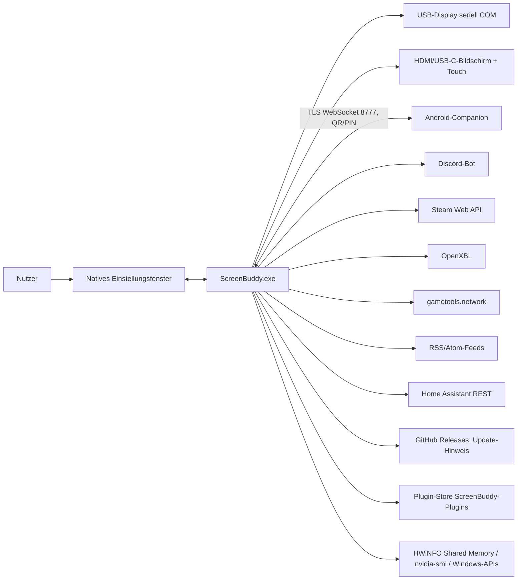
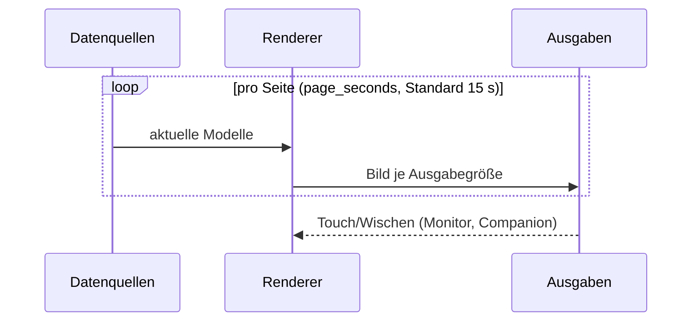

# ScreenBuddy · Architektur (arc42 kompakt)

Stand: 2.7.0. Dieses Dokument ist aus der Repository-Struktur (`cpp/src/`), dem [C++-README](../cpp/README.md) und den Release-Notizen abgeleitet. Aussagen zu einzelnen Dateien beruhen auf deren Namen und den dokumentierten Funktionen; was nicht im Quellcode nachgeprüft wurde, steht unter [Offene Punkte](#9-offene-punkte).

## 1. Einführung und Ziele

ScreenBuddy ist eine native Windows-App (C++20, eine EXE inklusive Installer) für 3,5-Zoll-USB-Displays (480 × 320) und zusätzliche HDMI-/USB-C-Bildschirme, optional mit Touch. Android-Geräte lassen sich über die Companion-App als weitere Anzeige koppeln.

| Ziel | Bedeutung |
|---|---|
| Einsatz ohne Vorkenntnisse | Assistent, Auto-Erkennung, bebilderte Anleitung DE/EN |
| Sicher | keine Administratorrechte, DPAPI für Schlüssel, Loopback-Dienst, geprüfte Plugins |
| Effizient | eine EXE, kein Python, kein WebView2 (ab 2.5), kein Visual-C++-Redistributable |
| Erweiterbar | deklarative, signierte Plugins aus dem Store |

## 2. Randbedingungen

- Windows 10/11 x64; Build mit Visual Studio Build Tools 2022, CMake/Ninja, vcpkg (Details: [`cpp/README.md`](../cpp/README.md#build)).
- Abhängigkeiten statisch gelinkt (u. a. D++ für Discord, OpenSSL).
- Die Windows-EXE ist unsigniert; Prüfsummen stehen in `SHA256SUMS.txt` am Release.
- MIT-Lizenz; Name und Logo per [Markenhinweis](../TRADEMARKS.md) ausgenommen.

## 3. Kontext

## 4. Lösungsstrategie

- **Ein Prozess, mehrere Ausgaben:** Seiten werden einmal pro Ausgabegröße gerendert und an USB-Display, Monitor und Companion geliefert.
- **Datenquellen entkoppelt:** jede Quelle liefert Modelle (`models.h`), die Renderer ist von den Quellen getrennt.
- **Selbst gezeichnete Oberfläche** (Direct2D/DirectWrite) statt WebView2; der lokale HTTP-Dienst bleibt für Companion-Kopplung und Anleitung.
- **Sicherheit durch Voreinstellung:** Plugins sind rein deklarativ, Installationen bleiben ausgeschaltet, Hosts brauchen Freigabe.

## 5. Bausteinsicht

Gruppierung nach den Dateien in `cpp/src/`:

| Baustein | Dateien | Aufgabe |
|---|---|---|
| Start und Ablauf | `main`, `app`, `tray` | Prozessstart, Hauptschleife, Infobereich-Symbol |
| Installation | `installer`, `winsetup`, `update` | Installer in der EXE, Windows-Einrichtung/Autostart, Update-Hinweis |
| Konfiguration | `config`, `secure`, `i18n`, `brand` | `config.toml`, DPAPI-Schlüssel, DE/EN-Texte, CI |
| Datenquellen | `sysinfo`, `discord`, `friends`, `bf6`, `rss`, `ha` | System, Discord, Freunde (Discord/Steam/Xbox), Battlefield 6, Blogs, Home Assistant |
| Netz und Schutz | `http`, `netguard`, `webui` | HTTPS-Abrufe, Prüfung auf nicht öffentliche Ziele, lokaler Loopback-Dienst |
| Darstellung | `render`, `gfx`, `models` | Seiten rendern, Grafikhilfen, Datenmodelle |
| Ausgabe | `output.h`, `serial_display`, `monitor_display`, `network_display`, `touch` | USB-Display, Vollbild-Monitor, Netzwerk-/Companion-Ausgabe, Touch-Eingabe |
| Companion | `companion`, `companion_server` | Kopplung, TLS-WebSocket, Gerätesitzungen (plattformneutral, unter Linux testbar) |
| Plugins | `plugins`, `plugin_render`, `plugin_settings`, `plugin_transport`, `plugin_catalog`, `plugin_catalog_net`, `plugin_store`, `plugin_sign` | Manifest, Rendern, Einstellungen, Abruf (nur GET auf öffentliche HTTPS-Hosts), Katalog/Index, Store, Signaturprüfung |
| Einstellungsoberfläche | `settings_window`, `native_settings`, `ui_kit`, `ui_logic`, `ui_pages`, `ui_page_*` | Fenster, Steuerelemente, Logik, eine Datei je Einstellungsseite |
| Ressourcen | `resources` | eingebettete Anleitung, Symbole, Versionsdaten |

Nicht Teil der aktuellen App: der historische Python-Stand 1.x im Hauptordner (`*.py`, `build.bat`) und `cpp/third_party/webview2` (nur Lizenz/Altlast).

## 6. Laufzeitsicht

- Mehrere Companions laufen seit 2.7 gleichzeitig, synchron oder unabhängig, mit eigener Auflösung und optional eigener Seitenliste.
- Kopplung: QR-Code oder PIN (6-stellig), Port 8777, nur private IPv4-Adressen, mDNS `_fuchslabs-display._tcp`, SHA-256-Fingerabdruck sichert TLS, Schlüssel DPAPI-geschützt in `companion.json` ([Protokoll](COMPANION-PROTOKOLL.md)).
- Update-Hinweis: höchstens einmal am Tag, nie automatische Installation.

## 7. Verteilung

Eine unsignierte `ScreenBuddy.exe` (Installer, App, Updater, Deinstaller). Standardziel `%LOCALAPPDATA%\FuchsLabs\USB-Display`. Daten: `config.toml`, `companion.json`, `usb-display.log`, `update-check.json`. Die Companion-APK 1.0.0 (signiert) ist ein separater Download. Plugins kommen aus dem Store-Repo `PapaFuchs84/ScreenBuddy-Plugins` (signierter Index, Pages).

## 8. Querschnitt

- **Sicherheit:** keine Admin-Rechte, keine Telemetrie; DPAPI; Dienst nur auf `127.0.0.1` mit Host-, Fetch-Metadata- und `X-FL: 1`-Prüfung; Ziele und Weiterleitungen gegen nicht öffentliche IP-Bereiche geprüft; Ed25519-signierter Store-Index mit festem öffentlichem Schlüssel und Sperrliste; Aktionen wie Schlösser oder Alarmanlagen in Home Assistant bewusst nicht schaltbar.
- **Sprache:** Standard folgt Windows; Texte in `cpp/src/i18n.cpp` und `ui_page_*.cpp`.
- **Design:** FuchsLabs-CI (Fuchs-Orange, Creme, Navy), hell/dunkel/eigene Farben mit Kontrastwarnung.
- **Tests:** Kern-, Parser-, Plugin-, Monitor-, Companion- und Installer-Prüfungen im Build (`cpp/tests/`); Echtgeräteprüfungen im [Testprotokoll](../cpp/TESTPROTOKOLL.md).

## 9. Offene Punkte

- Dieses Dokument wurde nicht gegen den Quellcode Zeile für Zeile geprüft; die Bausteintabelle gibt die Dateinamen und dokumentierten Funktionen wieder.
- Online-Plugins und CRL/OCSP-Prüfungen gelten weiter als experimentell.
- Packaging-Umleitung unter Windows kann einen anderen Einstellungsstand sichtbar machen (siehe [Release-Notizen 2.7](RELEASE-NOTES-2.7.md)).
- Juristische Prüfung der Store-Bedingungen steht aus.
