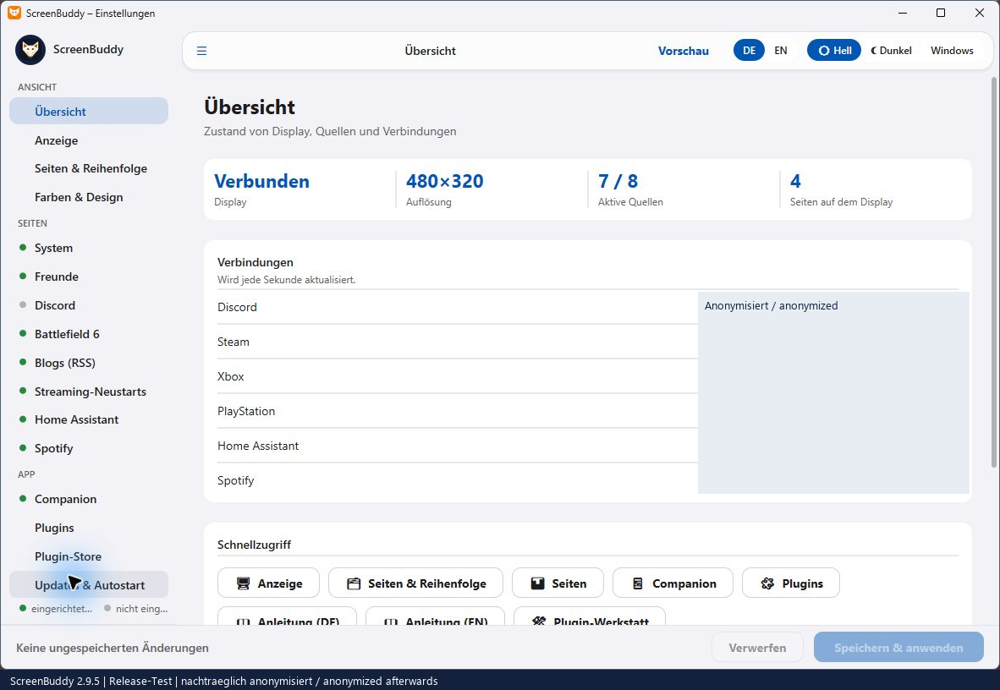
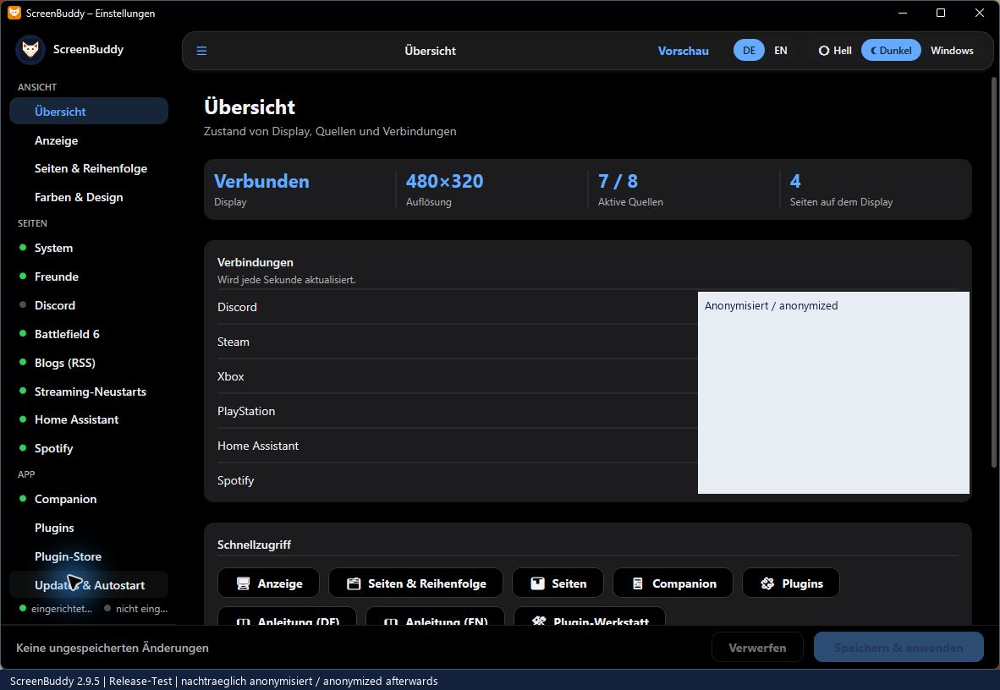
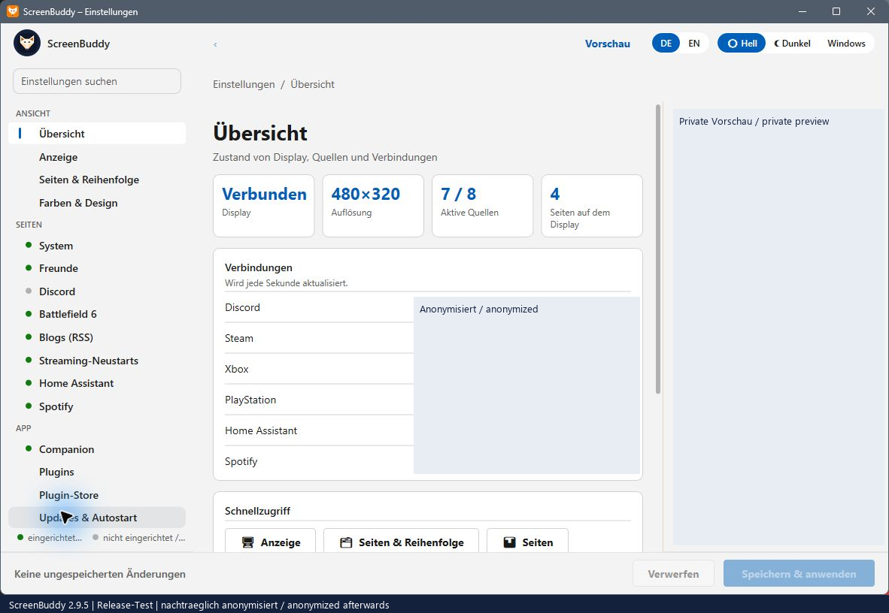
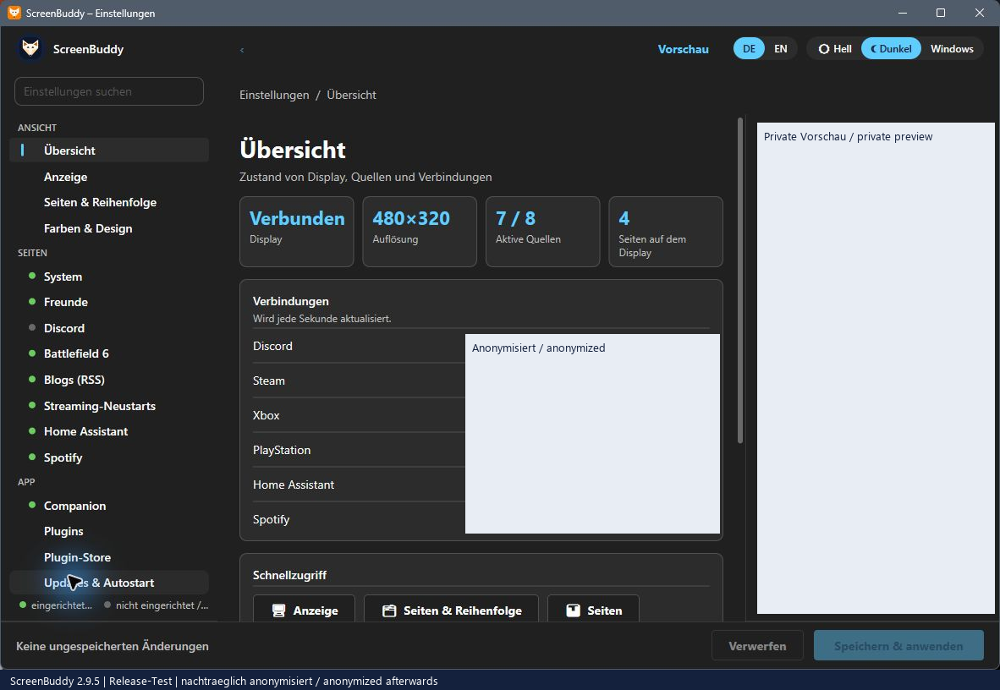
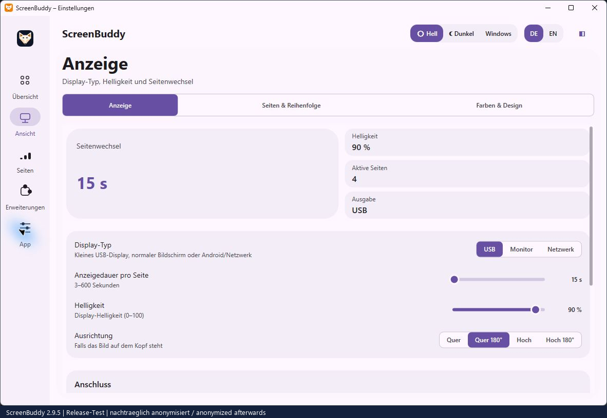
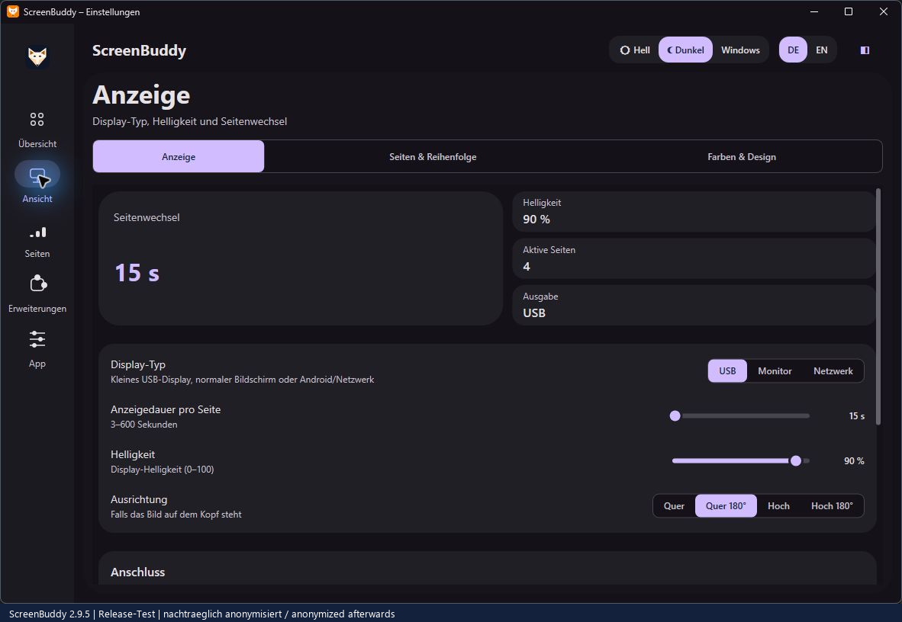

# Theme-Vergleich / Theme gallery

Native Aufnahmen aus der Release-Prüfung 2.9.5, anschließend anonymisiert. Deutsche UI; keine privaten Rohbilder. Die Galerie belegt die Fensterdarstellung, keine physische Panel-Abnahme.

## Cupertino

## Fluent

## Material

